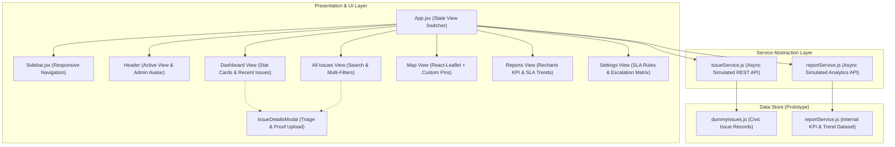

# Nagar Sudhar — Admin Dashboard

> Centralized Municipal Administration & Civic Issue Triage Platform

[](https://www.sih.gov.in/)
[](https://www.sih.gov.in/)
[](https://react.dev/)
[](https://vite.dev/)
[](https://tailwindcss.com/)
[](https://leafletjs.com/)
[](https://recharts.org/)

---

## Table of Contents

- [Project Overview](#project-overview)
- [Hackathon Context](#hackathon-context)
- [Problem Statement](#problem-statement)
- [Project Objectives](#project-objectives)
- [Implemented Features](#implemented-features)
- [Interface Preview & Screenshots](#interface-preview--screenshots)
- [Technology Stack](#technology-stack)
- [Application Architecture](#application-architecture)
- [Project Structure](#project-structure)
- [Getting Started](#getting-started)
- [Deployment](#deployment)
- [Related Repositories](#related-repositories)
- [Future Roadmap](#future-roadmap)
- [Author & Credits](#author--credits)

---

## Project Overview

**Nagar Sudhar** ("Urban Improvement") is a digital civic governance platform designed to bridge the operational gap between citizens and municipal authorities. While urban residents frequently encounter public infrastructure breakdowns—such as uncollected waste, hazardous potholes, non-functional streetlights, and sewer leakages—traditional complaint redressal systems remain opaque, slow, and fragmented across isolated government departments.

This repository hosts the **Admin Dashboard** for Nagar Sudhar. It serves as the municipality-facing command center where municipal administrators, ward supervisors, and department heads can:

1. **Monitor incoming civic grievances** submitted by citizens through the companion mobile/web interface.
2. **Prioritize and triage issues** using standardized severity metrics and departmental routing rules.
3. **Track geospatial incident distribution** on an interactive live map to deploy maintenance crews efficiently.
4. **Enforce Service Level Agreements (SLAs)** through data-driven performance analytics and resolution auditing.
5. **Verify issue resolution** through before-and-after photo evidence before closing complaints.

Within the broader Nagar Sudhar ecosystem, this dashboard functions as the resolution engine that complements the citizen-facing reporting application ([Nagar-Sudhar](https://github.com/mayankbuilds/Nagar-Sudhar)).

---

## Hackathon Context

This project was ideated and developed in the context of **Smart India Hackathon (SIH) 2025**:

| Attribute | Details |
| :--- | :--- |
| **Hackathon** | Smart India Hackathon 2025 (SIH 2025) |
| **Problem Statement ID** | SIH25031 |
| **Official Problem Statement Title** | Crowdsourced Civic Issue Reporting and Resolution System |
| **Theme** | Clean & Green Technology |
| **Category** | Software |
| **Team Achievement** | Our team was shortlisted at the college level for Smart India Hackathon (SIH) 2025 under Problem Statement SIH25031. |

> [!NOTE]
> *Recognition Clarification:* Our team was shortlisted at the **college level** during the internal evaluation round for SIH 2025. This project was not a national-level finalist, winning entry, or government-deployed production system.

---

## Problem Statement

Rapid urban expansion in India has intensified the strain on municipal service delivery. Municipalities routinely face:
- **Information Silos:** Complaints arrive via disparate physical channels, phone lines, or social media without centralized tracking.
- **Lack of Geospatial Visibility:** Field repair units lack precise geographic coordinates, leading to delayed response times and redundant site inspections.
- **Unclear Accountability:** Without predefined SLA targets and department-level accountability metrics, civic complaints often stagnate in administrative queues.
- **Verification Deficits:** Citizens have no transparent mechanism to confirm that reported issues were legitimately resolved on the ground.

The **Nagar Sudhar Admin Dashboard** directly addresses these challenges by transforming raw citizen reports into structured, geotagged, and department-routed actionable work items.

---

## Project Objectives

- **Centralized Civic Oversight:** Provide a unified web interface for municipal administrators to monitor all urban grievances across multiple categories.
- **Geospatial Hotspot Identification:** Visualize live incident locations on OpenStreetMap tiles using color-coded severity markers.
- **Transparent Triage & Lifecycle Tracking:** Enable administrators to update issue states (`pending` → `in-progress` → `resolved`) with administrative audit notes.
- **Resolution Proof & Accountability:** Require "After" image evidence before marking civic tickets as resolved.
- **Performance & SLA Monitoring:** Track departmental resolution speed, SLA compliance rates, and submission volume trends using data visualization.

---

## Implemented Features

The dashboard code contains the following verified, functioning features:

### 1. Centralized Executive Dashboard (`Dashboard.jsx`)
- **Dynamic KPI Stat Cards:** Automatically calculates and displays real-time counts for Total Reports, Pending Approval (`pending`), In Progress (`in-progress`), and Resolved (`resolved`) based on the active dataset and filters.
- **Category-Based Filtering:** Allows administrators to filter issues by municipal category (`All`, `Pothole`, `Litter/Garbage`, `Damaged Sign`, `Broken Streetlight`, `Illegal Dumping`, `Graffiti`, `Water Leak`, `Other`).
- **Recent Issues Summary Table:** Displays recent complaints with ID, Category, Severity badge, Submission timestamp, Status pill, and direct "Manage" triage triggers.

### 2. Master Issue Database (`AllIssues.jsx`)
- **Multi-Parameter Search & Filter Engine:**
  - Real-time text search across issue titles and unique ticket IDs.
  - Status filter dropdown (`All Statuses`, `Pending`, `In Progress`, `Resolved`).
  - Severity level filter (`All Severity`, `Low`, `Medium`, `High`, `Urgent`).
- **Responsive Data Table:** Lists comprehensive incident details with color-coded severity pills, status badges, and action triggers.
- **Dynamic Result Counter:** Live indicator reflecting the number of records matching current query parameters.

### 3. Interactive Live Geospatial Map (`MapView.jsx`)
- **Interactive OpenStreetMap Rendering:** Powered by Leaflet and React-Leaflet, providing pan, zoom, and coordinate-aware incident inspection.
- **Dynamic Severity-Coded SVG Markers:** Custom map pins rendered with distinct colors based on issue severity:
  - 🟢 **Low:** `#22c55e` (Green)
  - 🟡 **Medium:** `#facc15` (Yellow)
  - 🔴 **High:** `#dc2626` (Red)
  - 🔴 **Urgent:** `#991b1b` (Dark Red)
- **Interactive Marker Popups:** Displays ticket details including title, issue ID, category, severity, report timestamp, and status.
- **Resolved Marker Visibility Toggle:** Interactive checkbox allowing administrators to toggle visibility of resolved tickets to focus purely on outstanding municipal tasks.

### 4. Incident Triage & Resolution Modal (`IssueDetailsModal.jsx`)
- **Two-Column Audit Layout:**
  - *Citizen Report Details:* Title, ticket ID, category, severity, exact coordinates (latitude, longitude), report timestamp, citizen description, and the original "Before" photograph.
  - *Municipal Action:* Current status display, status transition dropdown selector (`pending`, `in-progress`, `resolved`), and resolution notes input.
- **Resolution Verification Upload:** Administrative file uploader with instant image preview for uploading "After" resolution photos as verifiable proof of work.

### 5. Analytics & Departmental Reports (`Reports.jsx`)
- **Key Performance Indicators (KPIs):** Executive metric cards tracking Resolution Rate (with 90% benchmark goal), Average Resolution Time, High Priority Backlog, and Monthly Report Volume.
- **Departmental Resolution Bar Chart:** Built with Recharts, comparing Actual Average Resolution Time, SLA Target Time, and Overdue Hours across municipal departments (Roads, Sanitation, Lighting, Waste).
- **Monthly Report Volume Trend Chart:** Responsive monotone line chart plotting historical complaint submission trends.
- **SLA Compliance Matrix Table:** Tabular breakdown displaying departmental hours vs. SLA targets with automatic "On Target" / "Behind Schedule" status indicators.

### 6. System Settings & SLA Configuration (`Settings.jsx`)
- **Severity Escalation Policy Matrix:** Reference tier defining platform alert behaviors for Medium, High, and Urgent severity tickets.
- **Automated Routing & SLA Target Table:** Municipal rules mapping issue types to responsible departments with standard SLA resolution windows (e.g., Pothole → Roads & Pavements [24h], Broken Streetlight → Public Lighting [48h], Water Leak → Sanitation [72h]).
- **Administrative Account & Integration Previews:** Interface hooks for municipal staff account counts and external GIS/notification API key statuses.

### 7. Responsive Navigation Shell (`Sidebar.jsx`, `App.jsx`)
- State-managed SPA navigation with persistent view tracking across Dashboard, All Issues, Map View, Reports, and Settings.
- Mobile-responsive sliding sidebar with backdrop toggle and branded header featuring official Nagar Sudhar icon branding.

---

## Interface Preview & Screenshots

> [!NOTE]
> Direct interface screenshots will be added in an upcoming documentation update as UI components receive further visual refinements.
> 
> The application's visual branding incorporates the project's official logo located at `src/assets/icon.png`.

---

## Technology Stack

| Layer | Technology | Version | Purpose in Application |
| :--- | :--- | :--- | :--- |
| **Frontend Framework** | [React](https://react.dev/) | `^18.3.1` | Component-based user interface and state management |
| **Build Tool & Dev Server** | [Vite](https://vite.dev/) | `^7.1.7` | Fast HMR development server and optimized ES module bundling |
| **Styling & Design System** | [Tailwind CSS](https://tailwindcss.com/) | `^3.4.4` | Utility-first responsive CSS styling with custom font configuration |
| **CSS Post-Processing** | [PostCSS](https://postcss.org/) / [Autoprefixer](https://github.com/postcss/autoprefixer) | `^8.4.38` / `^10.4.19` | Cross-browser CSS compatibility and vendor prefixing |
| **Interactive Mapping** | [Leaflet](https://leafletjs.com/) / [React-Leaflet](https://react-leaflet.js.org/) | `^1.9.4` / `^4.2.1` | Geospatial issue visualization with custom SVG pins and OpenStreetMap tiles |
| **Data Visualization** | [Recharts](https://recharts.org/) | `^3.2.1` | Declarative SVG-based bar and line charts for municipal analytics |
| **Linting & Code Quality** | [ESLint](https://eslint.org/) | `^9.36.0` | Static analysis with React Hooks and React Refresh rules |

---

## Application Architecture

The application is structured as a client-side Single Page Application (SPA) with a decoupled mock service layer:



### Architectural Highlights
- **Decoupled Service Abstraction:** `issueService.js` and `reportService.js` encapsulate all data retrieval behind asynchronous Promises with simulated network latency (300–500ms). This architecture ensures that replacing mock datasets with live REST or GraphQL endpoints requires zero refactoring of UI components.
- **Coordinated State Management:** Root state (`issuesData`, `reportData`, `currentView`, `loading`) is maintained in `App.jsx` and passed down to individual views via unidirectional props, preventing stale data across view transitions.

---

## Project Structure

```text
nagar-sudhar-dashboard/
├── index.html               # Main HTML entry point with Inter font & favicon
├── package.json             # Project dependencies, metadata, and build scripts
├── package-lock.json        # Exact dependency lockfile
├── postcss.config.js        # PostCSS configuration for Tailwind CSS
├── tailwind.config.js       # Tailwind CSS theme configuration and content paths
├── vite.config.js           # Vite configuration with React plugin
├── eslint.config.js         # ESLint flat configuration for React & hooks
├── README.md                # Project documentation and specifications
└── src/
    ├── main.jsx             # React DOM root initialization
    ├── App.jsx              # Root application shell and view router
    ├── index.css            # Base Tailwind imports and modal keyframe animations
    ├── assets/
    │   └── icon.png         # Nagar Sudhar brand icon and admin avatar
    ├── components/
    │   ├── Sidebar.jsx      # Responsive navigation sidebar
    │   └── IssueDetailsModal.jsx  # Triage modal for status updates & photo proof
    ├── data/
    │   └── dummyIssues.js   # Structured mock civic tickets (categories, severity, GPS)
    ├── pages/
    │   ├── Dashboard.jsx    # Executive summary with stat cards & filterable table
    │   ├── AllIssues.jsx    # Master database with text search & multi-dropdown filters
    │   ├── MapView.jsx      # OpenStreetMap interactive Leaflet map view
    │   ├── Reports.jsx      # Municipal performance analytics & Recharts visualizations
    │   └── Settings.jsx     # SLA rules, escalation matrix, and system preferences
    └── services/
        ├── issueService.js  # Async service layer for fetching/updating issue tickets
        └── reportService.js # Async service layer for municipal analytics and KPIs
```

---

## Getting Started

### Prerequisites
- **Node.js:** `v18.0.0` or higher (Vite 7 requires Node 18+ or 20+)
- **npm:** `v9.0.0` or higher (bundled with Node.js)
- **Git:** Installed and configured on your local machine

### Installation

1. **Clone the repository:**
   ```bash
   git clone https://github.com/mayankbuilds/nagar-sudhar-dashboard.git
   cd nagar-sudhar-dashboard
   ```

2. **Install project dependencies:**
   ```bash
   npm install
   ```

3. **Start the local development server:**
   ```bash
   npm run dev
   ```
   Open your browser and navigate to `http://localhost:5173` (or the port specified in your terminal).

### Available Scripts

Verified scripts defined in [`package.json`](./package.json):

| Command | Action |
| :--- | :--- |
| `npm run dev` | Starts the Vite development server with Hot Module Replacement (HMR) |
| `npm run build` | Compiles and bundles production-ready assets into the `dist/` directory |
| `npm run lint` | Executes ESLint across all `.js` and `.jsx` files to check code quality |
| `npm run preview` | Locally serves the production build from `dist/` for verification |

---

## Deployment

The project is configured for standard static frontend deployment. A production bundle can be generated using:

```bash
npm run build
```

The resulting `dist/` directory contains pre-rendered, optimized static assets (HTML, CSS, JS, images) suitable for hosting on platforms such as:
- **Vercel**
- **Netlify**
- **GitHub Pages**
- **Cloudflare Pages**
- **AWS S3 / CloudFront**

> [!NOTE]
> A live production deployment URL has not yet been officially configured for this repository. Automated CI/CD deployment pipelines will be established as backend integration matures.

---

## Related Repositories

The Nagar Sudhar platform consists of two collaborative components:

| Repository | Description | Role in Ecosystem |
| :--- | :--- | :--- |
| [**nagar-sudhar-dashboard**](https://github.com/mayankbuilds/nagar-sudhar-dashboard) *(This Repo)* | Municipality-facing administration dashboard | Complaint triage, GIS tracking, SLA enforcement, and resolution verification |
| [**Nagar-Sudhar**](https://github.com/mayankbuilds/Nagar-Sudhar) | Citizen-facing mobile/web application | Issue discovery, crowdsourced reporting, image uploads, and community tracking |

---

## Future Roadmap

The following enhancements represent planned architectural improvements based on the current implementation:

- [ ] **Full Backend & Database Integration:** Replace mock service modules (`issueService.js`, `reportService.js`) with a real REST/GraphQL API backed by PostgreSQL/PostGIS or MongoDB.
- [ ] **Role-Based Access Control (RBAC):** Implement authentication allowing distinct permissions for Municipal Commissioners, Department Supervisors, and Field Workers.
- [ ] **Real-Time Notification Pipeline:** Integrate WebSockets or Server-Sent Events (SSE) for instant alerts when urgent civic issues are reported.
- [ ] **Cloud Storage for Evidence:** Connect Before/After image upload handlers to cloud object storage (AWS S3, Cloudinary, or Firebase Storage).
- [ ] **Geospatial Density Heatmaps:** Integrate Leaflet heatmap plugins to visualize chronic civic issue clusters and inform long-term municipal urban planning.
- [ ] **Citizen Verification Loop:** Allow citizens who originally reported an issue to review the uploaded "After" photo and either confirm resolution or request re-investigation.

---

## Author & Credits

- **Mayank Kumar** — [GitHub Profile](https://github.com/mayankbuilds)
- **Project Repository:** [mayankbuilds/nagar-sudhar-dashboard](https://github.com/mayankbuilds/nagar-sudhar-dashboard)
- **Hackathon:** Smart India Hackathon (SIH) 2025 — Problem Statement SIH25031
